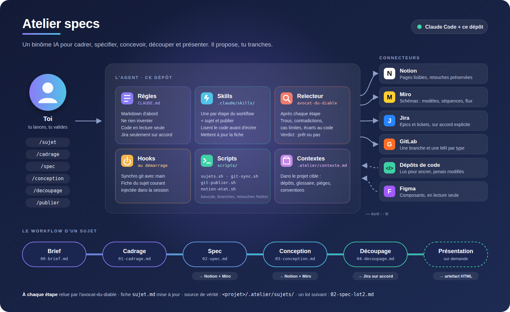

# atelier-specs

Un agent Claude Code qui sert de binôme pour **cadrer, spécifier, concevoir,
découper, chiffrer et présenter** des projets. Il propose, l'humain tranche.
L'atelier ne contient que l'outillage : le contexte et les sujets d'un projet
sont écrits en markdown **dans le projet lui-même** (`<projet>/.atelier/`),
puis publiés dans Notion, Miro et Jira.

## Installer l'atelier pour son équipe
1. Cloner le dépôt et l'ouvrir dans Claude Code.
2. **Configuration de l'équipe** : `cp .env .env.local`, puis remplir
   `.env.local` (non commité) : équipe, utilisateur, **projet cible**
   (`ATELIER_PROJET_DIR`), racine Notion, site et projet Jira, board Miro…
   `.env` liste toutes les clés.
3. **Projet cible** : `cp .claude/settings.local.json.example .claude/settings.local.json`
   et y mettre son chemin : lecture du code, écriture seulement dans `.atelier/`.
4. **Connecteurs** : connecter Notion, Atlassian et Miro (Figma si besoin) dans
   Claude.
5. **Contexte produit** : copier `templates/contexte.md` en
   `<projet>/.atelier/contexte.md` (dépôts, glossaire, pièges, conventions).
6. Vérifier : `./scripts/config.sh` affiche la configuration et signale les
   clés manquantes.

## Comment ça marche



<sub>Source éditable : [`docs/atelier.svg`](docs/atelier.svg). Après modification, régénérer le PNG :
`google-chrome --headless=new --hide-scrollbars --window-size=1600,980 --screenshot=docs/atelier.png docs/atelier.svg`</sub>

Chaque étape lit les précédentes, fait relire son livrable par
l'avocat-du-diable, puis met à jour la fiche `sujet.md` (étape, prochaine
action, décisions, journal). On peut donc reprendre un sujet à froid.

## Les briques

### Règles — `CLAUDE.md`
Chargé à chaque session. L'essentiel :
- **Markdown d'abord** : `<projet>/.atelier/sujets/<slug>/` est la source de vérité ; Notion en est
  la mise en page.
- **Ne pas inventer** : une info manquante devient une question ou une
  hypothèse affichée comme telle.
- **Ancrer dans le code** : on lit les dépôts avant de spécifier ou de concevoir,
  **en lecture seule**.
- **Jira** : aucune création ni modification sans accord explicite, et
  uniquement dans le site et le projet du contexte.
- **Notion + Miro** : publiés automatiquement à la fin de `/spec` et
  `/conception`, sur demande ailleurs.
- **Supprimer une règle = l'effacer partout** (markdown, Notion, Miro), sans
  marqueur « supprimée ».
- Vocabulaire métier du contexte, français, ton direct.

### Skills — `.claude/skills/`
| Skill | Rôle | Produit |
|---|---|---|
| `/sujet` | Lister, ouvrir, créer, mettre en pause, archiver un sujet | `.atelier/sujets/<slug>/sujet.md` |
| `/cadrage [lot]` | Brief → problème, périmètre, risques, questions | `00-brief.md`, `01-cadrage.md` |
| `/spec [lot]` | Le principe, parcours, règles RG, droits, aujourd'hui → demain, critères | `02-spec.md` |
| `/conception [lot]` | Choix structurants, BDD, API, front, vigilance (sans micro-détail) | `03-conception.md`, `adr/` |
| `/decoupage [lot]` | Epic et tickets chiffrés (fourchette en j/h), création Jira après accord | `04-decoupage.md` |
| `/publier [étape]` | Mise en page Notion + schémas Miro, sans écraser les retouches manuelles | pages Notion, `publication.md` |

Les fichiers d'un lot suivant sont suffixés : `02-spec-lot2.md`, etc.

### Agent — `.claude/agents/avocat-du-diable.md`
Relecteur critique lancé après chaque étape. Il ne lit que (Read, Grep, Glob) et
cherche : trous, contradictions, cas limites, non-fonctionnel oublié,
écarts avec le code. Il rend au plus 10 points classés bloquant / important /
mineur, puis un verdict : prêt / prêt avec réserves / à retravailler.

### Hooks — `.claude/settings.json`
Au démarrage de chaque session :
1. `scripts/git-sync.sh` aligne la branche de travail sur la branche
   principale du distant (sans commit de merge ; s'arrête et le dit en cas de
   doute).
2. `scripts/config.sh` injecte la configuration de l'équipe (`.env` +
   `.env.local`) et signale les clés manquantes.
3. `scripts/sujets.sh contexte` injecte la fiche du sujet courant (journal limité
   aux 5 dernières entrées).

### Permissions
- `.claude/settings.json` (commun) : lecture interdite des secrets (`.env*`,
  `auth.json`, clés JWT, secrets k8s), scripts de l'atelier autorisés sans
  confirmation. Claude ne lit donc jamais `.env*` : il passe par
  `scripts/config.sh`.
- `.claude/settings.local.json` (par personne, non commité) : projet cible
  ouvert en lecture, **écriture seulement dans `.atelier/`**, secrets propres
  au projet.

### Scripts — `scripts/`
| Script | Rôle |
|---|---|
| `config.sh` | Configuration de l'équipe (`.env` puis `.env.local`) : affichage, `get <CLE>` |
| `sujets.sh` | Sujets du projet cible : liste, sujet courant, bascule (`use <slug>`), contexte du hook |
| `git-publier.sh` | Commit + push sans checkout : `outillage/…` dans l'atelier, `atelier/<slug>/…` dans le projet cible ; une branche ouverte à la fois (pas de flood de MR) |
| `git-sync.sh` | Synchro de `travail` avec `origin/main` |
| `notion-etat.sh` | Repère les pages Notion retouchées à la main avant de les modifier |

### Contexte — `<projet>/.atelier/contexte.md`
Un fichier par produit ou client, partagé par ses sujets : dépôts à lire,
équipe, pièges techniques, glossaire métier, conventions (Jira, git, Figma).
Les identifiants des outils sont dans la configuration de l'équipe. Nouveau
projet : copier `templates/contexte.md`.

### Connecteurs
| Connecteur | Usage | Garde-fou |
|---|---|---|
| **Notion** | Pages lisibles : feature → lot → étape → thèmes | Écritures ciblées, retouches manuelles détectées et préservées |
| **Miro** | Schémas (modèle, séquences, flux), un cadre par lot et par étape | Copie Mermaid du schéma dans Notion |
| **Atlassian (Jira)** | Epics et tickets du découpage | Accord explicite, `JIRA_SITE` / `JIRA_PROJET` uniquement |
| **Figma** | Lecture de la bibliothèque de composants, si besoin | Lecture seule |
| **GitLab** (git) | Historique de l'atelier, MR par type de changement | Jamais de push sur `main` ni `travail` |

## Utilisation rapide
```
/sujet                     # lister et ouvrir un sujet
/sujet nouveau             # créer un sujet
/cadrage                   # puis coller le brief
/spec · /conception · /decoupage
/publier spec              # republier une étape dans Notion
```
Depuis un terminal : `./scripts/sujets.sh` (liste), `./scripts/sujets.sh use <slug>`.

## Structure
```
CLAUDE.md                 règles
.env                      clés de configuration (défauts) ; .env.local : valeurs de l'équipe, non commité
.claude/skills/           une skill par étape (+ sujet, publier)
.claude/agents/           avocat-du-diable
.claude/settings.json     hooks, permissions communes ; settings.local.json : dépôts de code
templates/contexte.md     modèle de contexte projet

<projet>/.atelier/        dans le projet cible :
  contexte.md             dépôts, glossaire, pièges, conventions
  sujets/<slug>/          fiche, livrables, publication.md, notion-etat.tsv
templates/                gabarits des livrables
docs/                     schéma de l'atelier (SVG source + PNG)
scripts/                  sujets, git, suivi Notion
```
